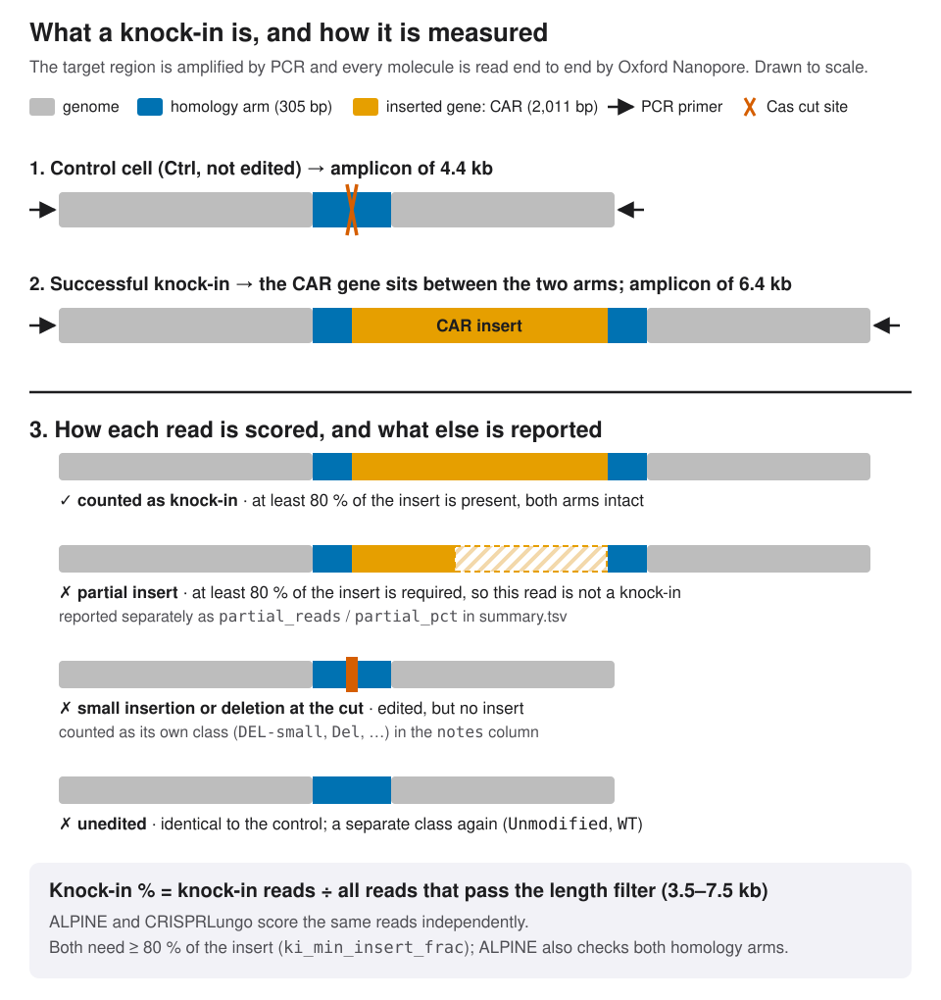
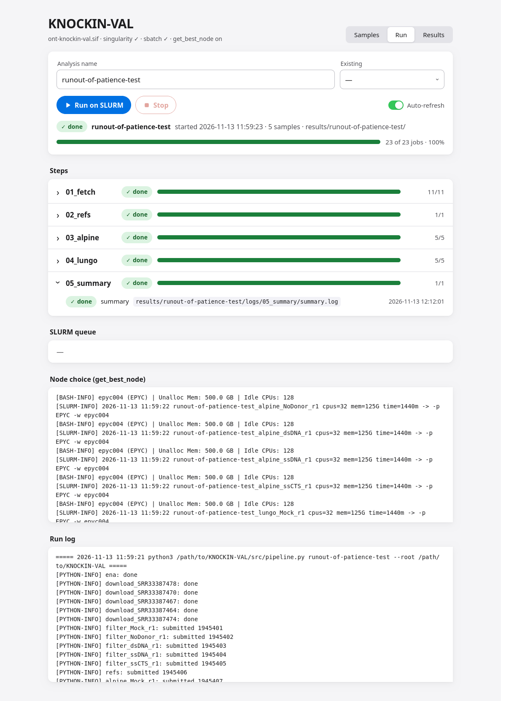
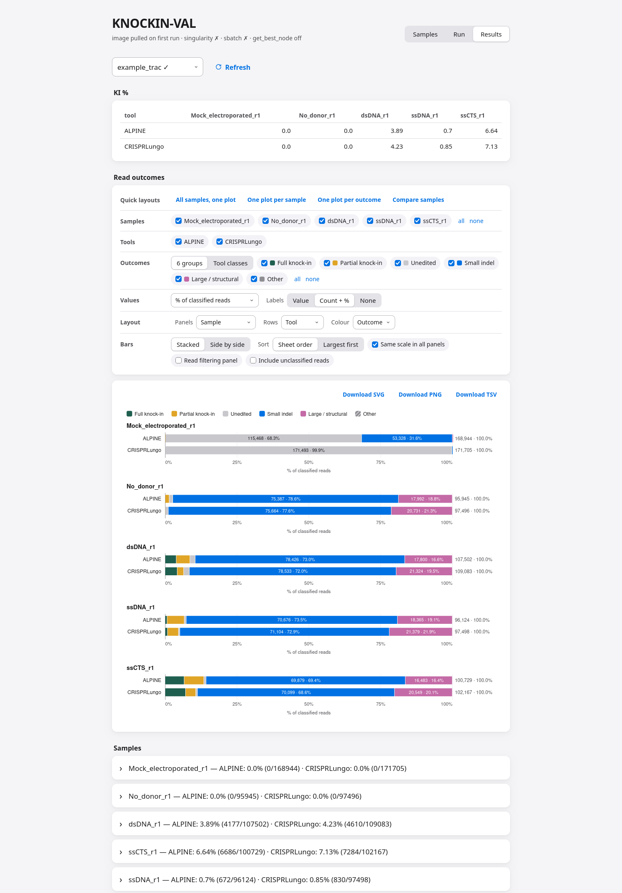

# KNOCKIN-VAL

KNOCKIN-VAL is a toolkit for validating CRISPR knock-in experiments with Oxford Nanopore Technologies (ONT) amplicon sequencing. It runs two independent knock-in callers on the same reads and reports their knock-in percentages side by side. Everything runs inside one container on a SLURM HPC cluster. The analysis itself is done by [ALPINE](https://github.com/Maggi-Chen/ALPINE) and [CRISPRLungo](https://github.com/pinellolab/CRISPRLungo), and we warmly thank their authors for making these tools openly available. This repository only orchestrates them, records provenance, and puts a simple web console in front of them.



| | |
|---|---|
| **Scope** | ONT reads of CRISPR knock-in PCR amplicons; tools with a native knock-in readout only |
| **Runs on** | a SLURM HPC cluster with Singularity/Apptainer; jobs are placed by `get_best_node` |
| **Full reference** | [Manual.md](Manual.md) · [ALPINE](docs/manuals/ALPINE.md) · [CRISPRLungo](docs/manuals/CRISPRLungo.md) · [Inputs](docs/manuals/Inputs.md) |

## Inputs and parameters

The console's info panel shows the same definitions, together with the current values.

### Input data types

- **FASTQ (local)** (gzipped FASTQ (`.fastq.gz`), one file per sample, absolute path on the cluster): The preferred source. Step `01_fetch` length-filters it with seqkit into `results/<analysis>/data/<sample_id>.fastq.gz`; the original file is never modified. A file outside `$HOME` and the repo needs `--bind <dir>` in `apptainer-args` (local FASTQ directories are bound automatically).
- **SRA run accession** (`SRR` / `ERR` / `DRR` followed by digits): The alternative source, for public data. Step `01_fetch` checks the read count against ENA, downloads the `.sra` file, converts it with `fasterq-dump` and keeps it in the shared cache `data/raw/<run>.fastq.gz`, so later analyses reuse it.
- **sample_id** (letters, digits, underscore): The row key. It names every file, log and SLURM job of the sample, so it must be unique within the sheet.
- **condition** (free text): A human-readable label for the treatment, e.g. `rnp_dsDNA_donor`. Carried into `summary.tsv` and the KI % matrix; not interpreted by the tools.
- **control_tier** (`treated` / `no_donor` / `mock`): What the sample was given, which is what makes it a control or not. At least one `mock` or `no_donor` row is required. CRISPRLungo's `--control` is the first `mock`, and failing that the first `no_donor` — a fixed rule, so the choice never depends on row order.

| Tier | Nuclease | Donor | What it measures | Expected KI % |
|---|---|---|---|---|
| `mock` | ✗ | ✗ | the sequencing and mapping error floor | ≈ 0 |
| `no_donor` | ✓ | ✗ | knock-ins called where knock-in is impossible — the false-positive floor | ≈ 0 |
| `treated` | ✓ | ✓ | the knock-in itself | the measurement |

  Both tiers matter and they are not interchangeable. `mock` is the cleaner background for CRISPRLungo's error model, because no allele in it was cut. `no_donor` is the one that bounds the knock-in claim: it is the only sample where a `HDR-*` call is certainly wrong, so its KI % is the floor the treated samples must clear. A sheet with only `treated` rows is refused.
- **Wet-lab and sequencing fields** (free text, dates, numbers): Provenance only. Stored in `configs/samples/<sample_id>.json` and copied into `results/<analysis>/meta/`; never read by the tools.
- **References (built by `02_refs`)** (`TRAC_WT.fa`, `TRAC_KI.fa`, `CAR_insert.fa`, `alpine/ref.fa`, `alpine/config.tsv`, `design.json`): Control (unedited) and knock-in amplicons, the inserted gene, guide, primers and homology arms. Built from a genome window (`refs.region`) and the donor template table of the paper (`refs.pmc`). The files are named after the example locus (`TRAC`, `CAR`); their roles are the same for any target.
  `design.json`'s `deleted_wt_bp_between_arms` is **−4** for the example design: the published homology arms overlap by 4 bp rather than deleting WT sequence between them, so the KI allele is 4 bp longer than WT + insert. That is a property of the paper's template, not a bug in `build_refs.py` — do not "correct" the negative value.


### Variables (`configs/param_configs.yaml`)

Each variable is listed with what it controls, the step that reads it, and the original argument it maps to in the tool.

- `shared.ki_min_insert_frac`: Minimum fraction of the inserted gene that a read must cover to be counted as a knock-in. 0.8 means at least 80% of the insert must be present; shorter, truncated integrations are not counted. The same threshold is applied to both tools so their percentages are comparable.
  - step: `03_alpine`, `05_summary`
  - original argument: ALPINE `truncated_cutoff` in job.yaml; for CRISPRLungo it is applied afterwards by `summarize.py` on the merged insert blocks
- `fetch.bioproject`: NCBI/ENA BioProject that the SRA runs belong to. Only used to download the run table from ENA, so that every downloaded run can be checked against its expected read count. Not needed when all samples are local FASTQ files.
  - step: `01_fetch` (jobs ena, download)
  - original argument: ENA filereport `accession=`
- `fetch.min_len`: Shortest read kept, in bp. Reads below this length are dropped before any tool sees them (primer dimers, broken reads). Nothing is subsampled: all passing reads are used. Note that 3500 sits below the 4358 bp WT amplicon, so any allele with a deletion larger than ~860 bp is removed before either tool sees it — a silent floor on large-deletion detection. It applies to both tools equally, so the KI % comparison is unaffected.
  - step: `01_fetch` (job filter)
  - original argument: `seqkit seq -m`
- `fetch.max_len`: Longest read kept, in bp. Removes concatemers and chimeric reads much longer than the knock-in amplicon.
  - step: `01_fetch` (job filter)
  - original argument: `seqkit seq -M`
- `refs.region`: hg38 genomic window (chromosome:start..end:strand) that contains the amplicon. Downloaded once from Ensembl and pinned by sha256.
  - step: `02_refs`
  - original argument: Ensembl REST `/sequence/region/human/<region>`
- `refs.pmc`: Europe PMC id of the paper whose supplementary table holds the HDR donor templates. Downloaded once and pinned by sha256.
  - step: `02_refs`
  - original argument: Europe PMC `supplementaryFiles`
- `build_refs.genomic_fasta`: Local path of the cached hg38 window downloaded from `refs.region`.
  - step: `02_refs`
  - original argument: `build_refs.py --yaml-in`
- `build_refs.genomic_start_1based`: 1-based genomic coordinate of the first base of `genomic_fasta`; converts positions in the window back to hg38 coordinates.
  - step: `02_refs`
  - original argument: `build_refs.py --yaml-in`
- `build_refs.templates_xlsx`: Supplementary spreadsheet containing the donor templates (full sequence and homology arms).
  - step: `02_refs`
  - original argument: `build_refs.py --yaml-in`
- `build_refs.template_title`: Exact title of the row in the supplementary table to use as donor; selects the knock-in construct.
  - step: `02_refs`
  - original argument: `build_refs.py --yaml-in`
- `build_refs.guide`: crRNA spacer sequence (5'->3'). Locates the cut site in the wild-type amplicon and is passed to CRISPRLungo.
  - step: `02_refs`, `04_lungo`
  - original argument: CRISPRlungo positional `<guide>`
- `build_refs.cut_offset_from_guide_5p`: Distance of the cut from the 5' end of the guide: 17 for SpCas9, 18 for AsCas12a. Wrong values shift the expected integration site.
  - step: `02_refs`
  - original argument: `build_refs.py --yaml-in`
- `build_refs.primer_f_full` / `primer_r_full`: Full PCR primers including adapters; define the amplicon ends that ALPINE searches for in each read.
  - step: `02_refs`, `03_alpine`
  - original argument: ALPINE `primer_1` / `primer_2` in job.yaml
- `build_refs.primer_f_specific` / `primer_r_specific`: Gene-specific part of the primers only; used to locate the amplicon in the hg38 window.
  - step: `02_refs`
  - original argument: `build_refs.py --yaml-in`
- `alpine.primer_check_length`: Number of bases at each read end in which ALPINE looks for the primers. Reads whose primers are not found there are discarded as incomplete amplicons.
  - step: `03_alpine`
  - original argument: ALPINE `primer_check_length` in job.yaml
- `alpine.data_type`: Read technology. `nanopore` tells ALPINE to expect ONT errors and also makes the pipeline patch ALPINE's hard-coded `minimap2 -ax map-hifi` into `map-ont`.
  - step: `03_alpine`
  - original argument: ALPINE `data_type` in job.yaml
- `lungo.cleavage_pos`: Position of the cut inside the guide as CRISPRLungo counts it; centres the window where edits are scored.
  - step: `04_lungo`
  - original argument: CRISPRlungo `--cleavage_pos`
- `lungo.window`: Half-width in bp around the cut in which CRISPRLungo scores indels and integrations. Larger values catch more distal edits but also more sequencing noise. **Do not lower this below 21 for the example design:** the donor's PAM-blocking mutations sit at cut −3..0 and at **+20 bp**, so 25 clears the furthest one by only 4 bp. At the upstream default of 5 that mutation falls outside the window and CRISPRLungo warns.
  - step: `04_lungo`
  - original argument: CRISPRlungo `--window`
- `threads`, `mem_mb`, `runtime`: CPU, memory (MB) and time (minutes) of each job, set in `src/pipeline.py`. `get_best_node` uses them to choose a partition and node with enough free resources when each job is submitted.
  - step: `every step`
  - original argument: `sbatch --cpus-per-task`, `--mem`, `-t`; CRISPRlungo `-t`; ALPINE coresMin/ramMin

Each analysis freezes its own copy of these values in `results/<analysis>/inputs/params.yaml`.

### Original command lines

| Step | Command |
|---|---|
| `01_fetch` | `seqkit seq -j <threads> -g -G - -m <min_len> -M <max_len> <raw.fastq.gz> -o data/<sample_id>.fastq.gz` |
| `03_alpine` | `cwltool --no-container aav_per_sample_workflow.cwl job.yaml` (fastqfile, reffile, config, primer_1/2, primer_check_length, data_type, truncated_cutoff, five/three_prime_HA_seq) |
| `04_lungo` | `CRISPRlungo TRAC_WT.fa <sample.fastq.gz> <out> <guide> --cleavage_pos <cp> --window <w> --control <control.fastq.gz> --induced_sequence_path TRAC_KI.fa --integration_file CAR_insert.fa -t <threads>` |
| `05_summary` | `python3 src/summarize.py --analysis-dir results/<analysis>` — writes `ki_reads`/`ki_pct`, `partial_reads`/`partial_pct` and the per-class `notes` |

## Quick start (SLURM HPC cluster)

| Step | Where | Command |
|---|---|---|
| 1. get the image | cluster, repo root | `srun -p THIN --mem=16G -c 4 --time=00:30:00 containers/build.sh pull` |
| 2. start the console | same shell | `python3 src/gui_serve.py` |
| 3. node name | same shell | `hostname -f` |
| 4. tunnel | laptop | `ssh -J <user>@<login-host> -L 8000:127.0.0.1:8000 -N <user>@<node>` |
| 5. open | laptop browser | http://127.0.0.1:8000/ |

| Automatic | Done by |
|---|---|
| `module load singularity` | `build.sh` (line 4) and `gui_serve.py` |
| node choice | `gui_serve.py` puts `src/sbatch_pick.sh` in front of `sbatch` |

## Console


### Samples

The page starts empty. **Example 1: Nitulescu 2025** fills in five public ONT runs of a published knock-in experiment (BioProject PRJNA1257358) and **Example 2: ARCUS 2025** three runs of a second one (BioProject PRJNA1183863), both credited under [Credits and citation](#credits-and-citation); saving an example also switches `configs/param_configs.yaml` to its parameters (see [Example datasets](#example-datasets)). **Clear** empties the cards. **Hide info** collapses the definitions above. Each card keeps the fields the pipeline needs; the sequencing and wet-lab fields sit at the end under **Optional details**, collapsed by default.


Each sample card has a **Local file | SRA** switch, with Local file as the default. While you type a path, the console checks that the file exists on the cluster and suggests folders and FASTQ files.


| Term | Definition |
|---|---|
| **Save samples** | validates, then writes `configs/samples.tsv` (`sample_id, fastq_path, srr, condition, control_tier`) and `configs/samples/<sample_id>.json` |
| **Load saved** | reopens the saved sheet |

### Run

The screenshot below is a finished run of the example data.



| Term | Definition |
|---|---|
| **Run on SLURM** | runs `src/pipeline.py <name>` on the login node: freezes inputs into `results/<name>/inputs/`, submits the jobs with `sbatch --dependency` and exits; jobs run unattended, there is no local mode |
| overall bar | finished jobs out of planned jobs |
| step rows | waiting / running / done / failed / cancelled / stopped per step, from files on disk plus `squeue`/`sacct`, each labelled in words and marked ✓ ✕ ▶ rather than by colour alone. A job counts as done once its output exists and its log ends with the footer. Failed jobs open with their log tail. |
| SLURM queue | only this run's jobs (`squeue -n <run id>`), with partition and node |
| node choice | `results/<name>/logs/node_pick.log`, one line per submitted job |
| header line | `image · singularity · sbatch · get_best_node`; a run is refused if `sbatch` or singularity is missing |
| resume | the same name again: done jobs are kept, the rest (and everything downstream) is resubmitted |
| stop | `pipeline.py <name> --stop` (`scancel` of this run's jobs) |

### Results

The Results tab on the example data, in the **one plot per sample** layout.



| Term | Definition |
|---|---|
| KI % | `results/<name>/summary_matrix.tsv`: tool × sample |
| Read outcomes | chart builder on `results/<name>/summary_classes.tsv`. You choose the **samples**, **tools** and **outcomes** (the 6 groups below, or each tool's own classes), the **values** (reads, or % of classified, length-passing or raw reads), the **layout** (what goes in separate panels, rows and colours: e.g. all samples in one plot, one plot per sample, one per outcome), **stacked or side by side** bars, labels (value, count + %, none), sort order and shared or per-panel scale. **Read filtering panel** adds raw → length-passing → classified reads per sample. **Quick layouts** set common combinations in one click; choices are remembered in the browser. **Download SVG / PNG / TSV** saves exactly what is shown. Colours are checked for colour-blind readers, keep the same colour per sample/tool/outcome whatever is selected, and every bar has a legend entry and a hover label. |
| per sample | `results/<name>/meta/<sample_id>.json`: submitted fields plus one record per step |


| Console setting | Definition |
|---|---|
| bind | `127.0.0.1` only (no login; jobs are submitted as you) |
| host | the cluster login node, never inside the container (needs `sbatch`) |
| port | `--yaml-out` → edit `gui_serve.port` in `configs/param_configs.yaml` → `--yaml-in` |

| Tunnel symptom | Cause |
|---|---|
| browser: *Unable to connect* | ssh tunnel not running on the laptop |
| `channel … connect failed` | console not listening on that node |
| `-L 8000:<node>:8000 <user>@<login-host>` refused | console binds loopback; use `-J` |
| ssh to node refused | no job of yours on that node |

## Node placement (`get_best_node`)

For each job `pipeline.py` submits, `src/sbatch_pick.sh`:
1. reads `--cpus-per-task`, `--mem` and `-t`;
2. keeps the partitions whose time limit covers the job, never DGX or GPU;
3. asks `get_best_node` (`src/best_node.sh`) for the idle or mixed node with the most free CPUs and memory;
4. submits with `-p <partition> -w <node>`.

If no node fits, the default partition (GENOA) is kept. `NODE_PICK=0` turns this off.

## Pipeline


| Step | Job | Does | Writes (in `results/<name>/`) |
|---|---|---|---|
| `01_fetch` | `ena` · `download` · `filter` | SRA reads (cached) or local FASTQ, length filter | `data/<sample>.fastq.gz`, `data/stats/` |
| `02_refs` | `refs` | WT / KI references, ALPINE config | `refs/` |
| `03_alpine` | `alpine` | ALPINE, all reads, one job per sample | `ALPINE/<sample>/` |
| `04_lungo` | `lungo` | CRISPRLungo, all reads, one job per sample | `CRISPRLungo/<sample>/` |
| `05_summary` | `summary` | KI % per tool × sample | `summary.tsv`, `summary_matrix.tsv`, `summary_classes.tsv` |
| every job | — | log, provenance via `src/sample_meta.py` | `logs/<step>/`, `meta/<sample_id>.json` |


Command-line equivalent of the console:

```bash
python3 src/analysis.py <name>                  # freeze inputs
python3 src/pipeline.py <name> --dry-run        # show what would be submitted
python3 src/pipeline.py <name>                  # submit; run again to resume
python3 src/pipeline.py <name> --stop           # scancel this analysis' jobs
cat results/<name>/summary_matrix.tsv           # KI % per tool x sample
```

`pipeline.py` plans the jobs (`01_fetch`: `ena`, `download` per SRA run, `filter` per sample; `02_refs`; `03_alpine` and `04_lungo` per sample; `05_summary`) and submits them with `sbatch --dependency=afterok:... --kill-on-invalid-dep=yes`, each through `src/kv_job.sh`, which runs the step inside the image and then checks the job's outputs (exist, non-empty, `gzip -t` for `.gz`); a job that fails the check fails, so its dependents never start. Job ids go to `results/<name>/jobs.tsv`.

| Resume and safety | Definition |
|---|---|
| done rule | every output exists and is non-empty, the log ends with the `kv_footer` line (not required for the shared `data/raw`, `data/meta` cache), and no output is older than an output of a job it depends on |
| resume | run the same command again: only jobs not done, and everything downstream, are resubmitted |
| frozen inputs | sha256 of `results/<name>/inputs/` kept in `inputs/analysis.json` and re-verified every launch; edited inputs are refused (create a new analysis); local FASTQ size + mtime are re-verified too |
| pre-flight | every input of every job to run must exist or be produced in this launch, else nothing is submitted |
| paths | outputs and logs must resolve inside `results/<name>/`, `data/raw` or `data/meta` |
| one launch | lock `results/<name>/.lock`; refused while the analysis has live SLURM jobs, or another analysis has a live job writing the same shared download |
| environment | `SLURM_*`/`SBATCH_*` are scrubbed, so launching from an `salloc` shell is safe |
| timing | `sacct -j <id> -o JobID,Elapsed,MaxRSS` |

## Metrics

| Term | Definition |
|---|---|
| ALPINE KI | `HDR-<name>` class: insert ≥ `ki_min_insert_frac` **and** both homology arms aligned |
| CRISPRLungo KI | integration blocks matching the insert, **merged**, cover ≥ `ki_min_insert_frac` of the insert |
| `metric` column | the definition used for each row of `summary.tsv` |
| denominator | length-passing reads (`reads_used`), not all reads |
| control caveat | the CRISPRLungo control is ≈ 0 by construction; use `NoDonor` as its negative |
| ALPINE vs CRISPRLungo | ALPINE counts precise HDR only and is expected to be lower; see [docs/manuals/ALPINE.md](docs/manuals/ALPINE.md) |

### Reads that are not knock-in are not thrown away

A read that is neither a clean knock-in nor unedited is still counted and reported, so a failed experiment can be told apart from a partly successful one.

- **Partial inserts (more than 0 but below the threshold)** are counted in their own columns of `summary.tsv`: `partial_reads` and `partial_pct`. For ALPINE these are the `Non-HDR-...` classes, which is exactly what ALPINE calls a read whose insert is too short; for CRISPRLungo they are reads with some insert integration whose merged blocks cover less than `ki_min_insert_frac` of the insert.
- **Everything else is distinguished too, not merged into "not knock-in".** Both tools classify every read, and the full class breakdown with percentages goes into the `notes` column of `summary.tsv`. A small insertion or deletion at the cut is therefore a different outcome from an unedited read: ALPINE reports `Unmodified`, `Unmodified-with-SNP`, `DEL-small`, `INS-small`, `DEL-large`, `INS-large`, `INV`, `DUP`, `Unclassified`; CRISPRLungo reports `WT`, `Sub`, `Ins`, `Del`, `LargeIns`, `LargeDel`, `Inv`, `Complex`, `ComplexWithLargeMut`.
- The per-read tables are kept as well, under `results/<name>/ALPINE/<sample>/` and `results/<name>/CRISPRLungo/<sample>/results/`, if you want to go back to individual reads.

`summary_classes.tsv` has one row per tool, sample and tool class (`tool, sample_id, category, class, reads, pct`), with `pct` over `reads_used` for every row. Each class goes into one of seven groups; the first six add up to `reads_used`, and `Unclassified` is counted separately:

| Group | ALPINE classes | CRISPRLungo reads |
|---|---|---|
| Full knock-in | `HDR-*` | merged insert blocks ≥ `ki_min_insert_frac` (any class) |
| Partial knock-in | `Non-HDR-*` | merged insert blocks > 0 but below the threshold |
| Unedited | `Unmodified`, `Unmodified-with-SNP` | `WT` |
| Small indel | `DEL-small`, `INS-small` | `Sub`, `Ins`, `Del` |
| Large / structural | `DEL-large`, `INS-large`, `INV`, `DUP` | `LargeIns`, `LargeDel`, `Inv`, `Complex*` |
| Other | anything not matched above | anything not matched above |
| Unclassified **(excluded from `reads_used`)** | `Unclassified` | — |

**Why `Unclassified` is excluded.** ALPINE keeps the reads it cannot place as an `Unclassified` class — mostly reads failing its primer, quality or full-length checks. CRISPRLungo has no equivalent: reads it cannot classify never reach its table at all. Counting ALPINE's in the denominator while CRISPRLungo's are already gone would make the two tools' percentages answer different questions, so they are excluded from `reads_used` and reported in their own `unclassified_reads` column. They are not deleted: the class rows stay in `summary_classes.tsv`, the count is in `unclassified_reads`, and the Results tab can chart them (**Include unclassified reads**) or show them as the drop from length-passing reads to classified reads (**Read filtering panel**).

Only the literal `Unclassified` class is excluded. An unrecognised class goes to `Other`, which stays in `reads_used` — an unexpected outcome must never silently inflate the knock-in percentage.

The KI % matrix shows only `ki_pct`; the Results tab charts the groups per sample.

## Containers


| Command | Where | Does |
|---|---|---|
| `build.sh build` | workstation (Docker) | builds the image |
| `build.sh lock` | workstation | writes `containers/kv.lock.txt` |
| `build.sh ship` | workstation | login + push, records the digest in `containers/images.env`, prints the cluster pull commands |
| `build.sh pull` | SLURM HPC cluster | `singularity pull` of the pinned digest → `containers/ont-knockin-val.sif`; the unit tests run in the background during the pull, then a container smoke test (tools present, imports work). Exits non-zero if either fails; `KV_SKIP_TESTS=1` skips the unit tests |
| `build.sh test` | SLURM HPC cluster | the same unit tests + smoke test, without pulling |

| Variable | Definition |
|---|---|
| `KV_OWNER` | GHCR namespace (default: owner of `origin`) |
| `KV_GITHUB_TOKEN` | PAT with `write:packages`, push only |
| `KV_ENGINE` | `docker` (default) or `podman` |
| `KV_SIF` | image the jobs run in (default: the `.sif`, else the pinned digest) |
| `--cleanenv` | host environment does not leak into jobs |
| `--bind` | add to `apptainer-args` for data outside the repo (symlink targets too) |

## Example datasets

Two published experiments are wired up, each in its own folder under `configs/examples/`
(`example_nitulescu/`, `example_arcus/`) with a `samples.tsv`, a `param_configs.yaml` and a `meta.yaml`
(button label, title, credit). Example 1 is the default: `configs/param_configs.yaml` is already set up for it.
In the console, the **Example 1** / **Example 2** buttons fill the sample cards; **Save samples** then also copies
that example's `param_configs.yaml` over `configs/param_configs.yaml` (the previous one is kept as
`configs/param_configs.yaml.bak`). From the shell, copy the two files over the defaults instead.

| | Example 1 (default) | Example 2 |
|---|---|---|
| Analysis name | `example_trac` | `example_arcus` |
| Paper | Nitulescu et al. 2025, doi:10.1016/j.omtn.2025.102568 | Nucleic Acids Res 2025, doi:10.1093/nar/gkaf961 |
| BioProject | PRJNA1257358 | PRJNA1183863 |
| Nuclease | AsCas12a, 23 nt guide | ARCUS meganuclease, 22 bp recognition site |
| Donor | dsDNA / ssDNA / ssCTS, CD19-CAR insert | AAV6, 2.8 kb skip with a 500 bp right homology arm |
| Amplicon | 5.4 kb | 9.6 kb (chr14:22542700-22552299) |
| KI allele | 2.0 kb insert | 583 bp cassette replacing 2851 bp of WT, so the KI amplicon is **shorter** (7.3 kb) |
| Samples | 5 (`mock`, `no_donor`, 3 × `treated`) | 3 (`no_donor`, 2 × `treated`) |
| Donor sequence from | the paper's Table S1 (`templates_xlsx`) | the reads (`donor_ki_fasta`) |

Both target *TRAC* and share the same 20 kb genome window, so `refs.region` is identical. Example 2 is the
reason `build_refs.py` takes `donor_ki_fasta`: ARCUS's repair template is not published as a sequence, so
there is no table to read it from.

```bash
cp configs/examples/example_arcus/samples.tsv configs/samples.tsv
cp configs/examples/example_arcus/param_configs.yaml configs/param_configs.yaml
python3 src/analysis.py example_arcus
python3 src/pipeline.py example_arcus --root $PWD
```

### How example 2's donor was reconstructed, and what that costs

`configs/examples/example_arcus/donor_ki.fa` is not a published sequence. It was built here from
SRR31290121, the sorted B2M−CD3+ population the paper reports as correctly inserted:

1. Reads 7.0-7.5 kb long were mapped to the genome window; 95% of them share one structure, a ~2.3 kb net
   genomic deletion with no foreign insertion, because the cassette is *recoded TRAC exon* sequence that
   still aligns to the genome.
2. The median such read became a backbone, the other 550 were mapped back to it, and `samtools consensus`
   polished it at 546x depth.
3. The final allele is composed rather than used raw: the two flanks are taken from the hg38 window and only
   the 583 bp that does not align to the genome comes from the consensus. The result has no `N`.

Three honest limits of this:

- **The junctions can slide by a base or two.** They are inferred from where the donor stops matching WT, so
  a cassette end that happens to repeat a WT base extends the apparent flank. `build_refs.py` reports
  `cut_site_0b` 5003 from the ARCUS site while the inferred junction is at 5005; both sit inside the 4 nt
  3' overhang that this nuclease leaves, so they are consistent, but do not read the junction as exact.

  The cut itself is confirmed from the data, not just from the nuclease's geometry: in the nuclease-only
  control (SRR31290119), reads carrying an indel of 3 bp or more cluster at WT 4980-5009, which brackets
  both the 22 bp recognition site (4992-5013) and the computed cut. Three apparently larger hotspots in the
  same control are **homopolymer artefacts, not cuts** — 23xT at WT 5945, 18xA at 1225 and 9xA at 8475 are
  the usual nanopore indel sites. This is also why `lungo.window` 25 is safe here: the worst of them is
  940 bp away from the cut, far outside the window CRISPRLungo counts indels in.
- **`primer_f_specific` / `primer_r_specific` are not the real primers.** The paper does not publish them.
  They are the first and last 25 bp of the observed amplicon, which anchors the same window; `design.json`
  records them as primers because that is the field they fill.
- **`fetch.min_len` 6000 is a floor on deletion size.** The WT amplicon is 9.6 kb and the KI 7.3 kb, so any
  allele that lost more than ~3.5 kb is filtered out before either tool sees it, and will not appear as a
  large deletion.

## Reproducibility

| Input | Pin | File |
|---|---|---|
| ALPINE, CRISPRLungo | 40-char commit SHA | `configs/tools.tsv` |
| base image · built image | manifest digest | `containers/pins.env` · `containers/images.env` |
| conda packages | URL + md5 | `containers/kv.lock.txt` |
| hg38 region, paper xlsx | sha256 | `configs/refs.sha256` |
| reads | SRA accession, or local path as submitted | `results/<name>/inputs/samples.tsv` |
| analysis inputs | copied at creation | `results/<name>/inputs/` |

## Credits and citation

- **Tools.** ALPINE (Chen et al., *Bioinformatics* 2026) and CRISPRLungo (Hwang, Pinello et al., *Nature Biomedical Engineering* 2026) do the analysis. Please cite them if you use these results. Their licences are in [LICENSES.md](LICENSES.md).
- **Example data.** The example samples are public reads of: Nitulescu A-M, Du W, Glaser V, et al. *Single-stranded HDR templates with truncated Cas12a-binding sequences improve knock-in efficiencies in primary human T cells.* Mol Ther Nucleic Acids 36(2):102568 (2025), [doi:10.1016/j.omtn.2025.102568](https://doi.org/10.1016/j.omtn.2025.102568), reads in SRA BioProject [PRJNA1257358](https://www.ncbi.nlm.nih.gov/bioproject/PRJNA1257358). The paper is open access under CC BY-NC-ND 4.0. Nothing from it is copied here: reads and the supplement are downloaded from their original source when you run the pipeline. Details in [LICENSES.md](LICENSES.md#example-data).
- **Second example data.** *High-efficiency homology-directed insertion into the genome using the engineered homing endonuclease ARCUS.* Nucleic Acids Res (2025), [doi:10.1093/nar/gkaf961](https://doi.org/10.1093/nar/gkaf961), reads in SRA BioProject [PRJNA1183863](https://www.ncbi.nlm.nih.gov/bioproject/PRJNA1183863). Open access under CC BY-NC 4.0. With thanks to the authors at Precision BioSciences for releasing a nuclease-only control alongside the edited samples — that control is what lets this example show a true `no_donor` tier.

## Development

| Item | Definition |
|---|---|
| tests | run automatically by `containers/build.sh pull`; alone: `containers/build.sh test` or `python3 -m pytest -q tests` (host python3 needs `pytest pyyaml openpyxl`) |
| diagrams | edit `docs/diagrams/*.dot` → `bash src/diagrams.sh` |
| gitignored | `tools/ data/ results/ .singularity/ .kv_bin/ .kv_env/` |
