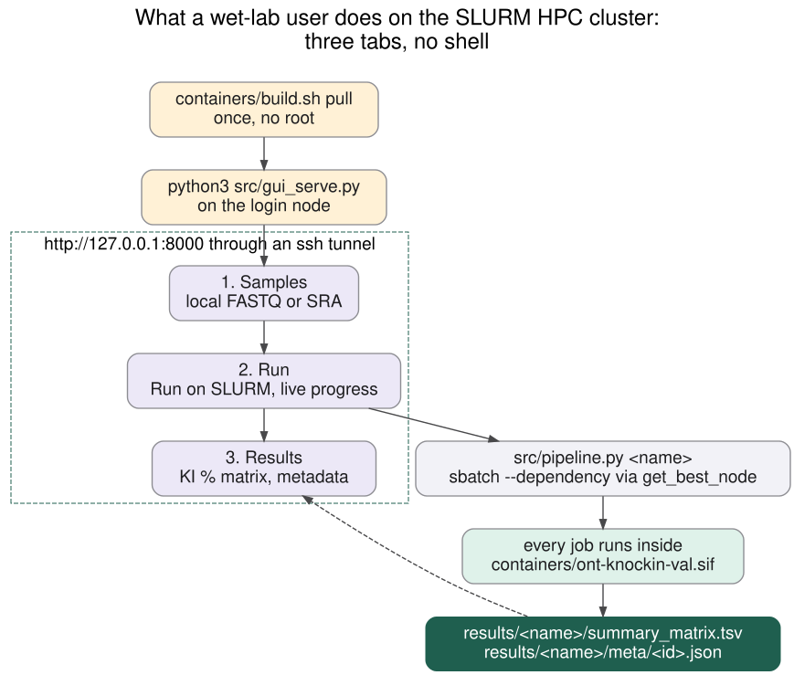
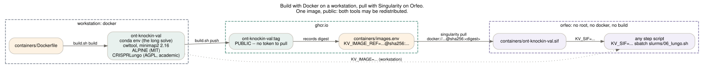
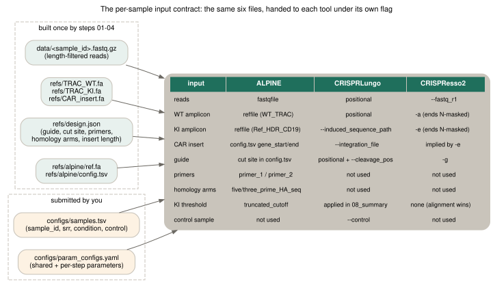
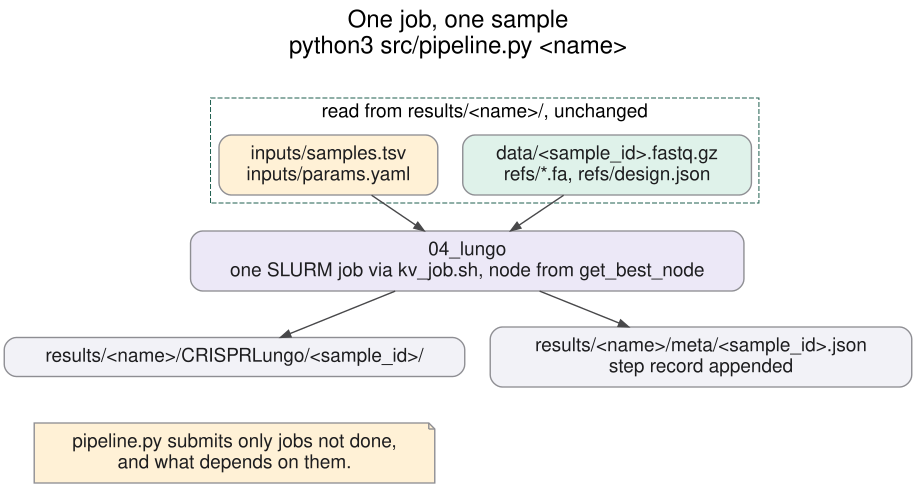
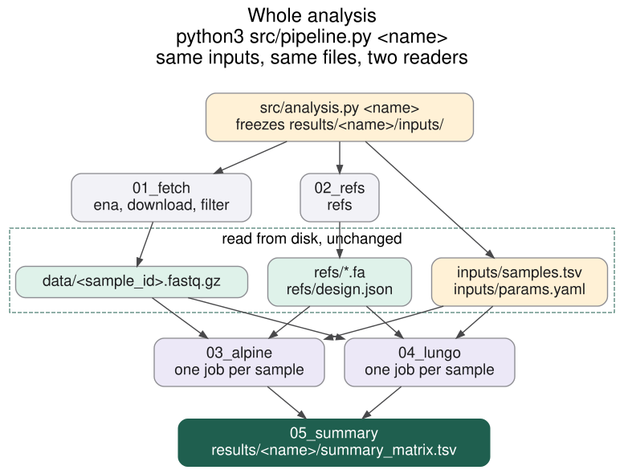
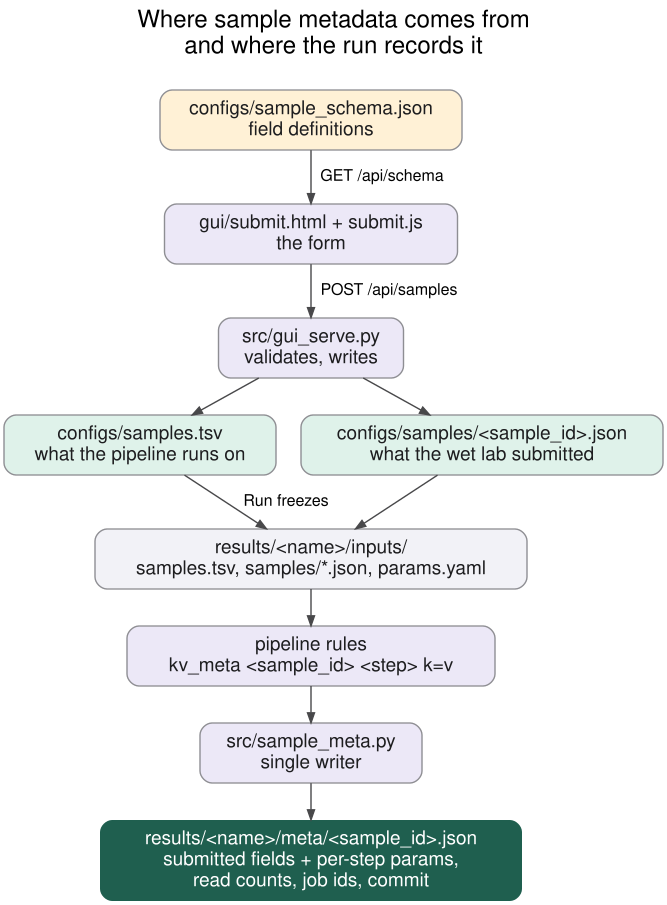

# KNOCKIN-VAL

Wrapper to run two long-read CRISPR **knock-in** analysis tools on the same ONT amplicon data: **ALPINE** and **CRISPRLungo**.

> A third tool, CRISPResso2, was part of this pipeline until 2026-11-11 and was removed: its licence
> forbids copying it in any form, so it could not ship in the image. [LICENSES.md](LICENSES.md) records
> what that cost and what it bought.

Scope: Oxford Nanopore sequencing of CRISPR knock-in PCR amplicons. Only tools with a native knock-in readout are included.

## The console

On Orfeo, from the repo root:

```bash
containers/build.sh pull                # 1. fetch the image once (~5 GB); loads singularity itself
hostname -f                             #    note the node, e.g. genoa001.hpc.rd.areasciencepark.it
python3 src/gui_serve.py                # 2. start the console
```

No `module load` or `conda activate` needed: the console runs `module load singularity` in a login shell
if singularity is missing, and finds the `kv_snakemake` conda env (creating it in `.kv_env/` from `envs/snakemake.yml`
the first time) if snakemake is missing.

From your laptop, then open http://127.0.0.1:8000/:

```bash
ssh -J <user>@195.14.102.215 -L 8000:127.0.0.1:8000 -N <user>@<that node>   # 3. tunnel
```



The page has three tabs:

1. **Samples** — one card per sample. Saving writes `configs/samples.tsv` and one
   `configs/samples/<sample_id>.json` (operator, date, cell type, donor format, dose, flow cell, notes).
   Fields come from `configs/sample_schema.json`; add one there and it appears in the form and the JSON and
   nowhere else. Editing `configs/samples.tsv` by hand still works.
2. **Run** — name the analysis and press **Run on SLURM**. Snakemake submits one job per sample per tool,
   with the dependencies implied by the files, and everything lands in `results/<name>/`. The tab shows the
   queue, per-step progress and the tail of the snakemake log, refreshing every 5 seconds. Re-running the
   same name resumes it: finished files are kept, missing ones are recomputed.
3. **Results** — pick an analysis to see its knock-in % matrix and, per sample, its full
   `results/<name>/meta/<sample_id>.json`: what the wet lab submitted, what each step did, read counts,
   SLURM job ids, the image and the tool commits.

The console picks up `containers/ont-knockin-val.sif` automatically if it exists; otherwise snakemake pulls
the pinned digest on the first run. The header line reports what it found (`image … · snakemake ok ·
apptainer ok · sbatch ok`) and the Run button refuses to start if any of the three is missing.
**Run the console on the host, not inside the container** — it needs `sbatch`, which a container cannot reach.

Two things that trip people up on a cluster. The tunnel must end **on the node the console runs on**, and
the console listens on `127.0.0.1` only (it submits SLURM jobs as you and has no login), so
`ssh -L 8000:<node>:8000 <user>@<login>` is refused: the login node would connect to the node's network
interface, where nothing listens. `-J` jumps through the login node and forwards to the node's own
loopback instead. ssh into a compute node only works while you hold a job there. And if port 8000 is
already taken, change it once:

```bash
python3 src/gui_serve.py --yaml-out      # writes a [gui_serve] block to configs/param_configs.yaml
vim configs/param_configs.yaml           # set port: 8010
python3 src/gui_serve.py --yaml-in       # and forward 8010 instead
```

## How to run

The pipeline is a [Snakemake](https://snakemake.readthedocs.io) workflow. Every run is an **analysis**
with a name, and everything it produces lives in `results/<name>/`.

```bash
module load singularity                                                 # every new shell
conda env create -f envs/snakemake.yml && conda activate kv_snakemake   # once
containers/build.sh pull                                                # once, ~5 GB

python3 src/analysis.py trac_cd19_2026_11                 # freeze the inputs
snakemake --profile profiles/slurm --config analysis=trac_cd19_2026_11
cat results/trac_cd19_2026_11/summary_matrix.tsv          # knock-in % per tool x sample
```

`profiles/slurm` submits one job per sample per tool through the SLURM executor, with per-rule CPU, memory
and walltime; `profiles/local` runs the same graph on the current machine. Interrupt it and run the same
command again — finished outputs are kept and only what is missing is recomputed.

**The workflow only runs inside the container.** The Snakefile refuses to start without apptainer
(`refusing to run natively`), and every step script re-checks that it is inside the image. There is no
native mode to fall back into, and so no way to silently analyse data with whatever happened to be on PATH.

Only `snakemake`, `singularity`/`apptainer` and `curl` are needed on the cluster. The tools, their conda
environment and their pinned commits are all inside the image.

## Containers

Orfeo does not build images and does not run Docker. So the image is **built with Docker on a workstation,
pushed to GHCR, and pulled on Orfeo with Singularity**, which converts it to a `.sif` on the way in. No
root and no build tooling are needed on the cluster. The tools and their conda environment are baked in,
which is the part most likely to rot — there is no clone or env-build step at run time at all.

Both tools are redistributable, so there is **one image** and it is public — no token is needed to pull
it on Orfeo (see [LICENSES.md](LICENSES.md)):



### On the workstation (Docker)

```bash
export KV_OWNER=<your lowercase github namespace>      # defaults to the owner of 'origin'
export KV_GITHUB_TOKEN=<PAT with write:packages>       # only needed to push

containers/build.sh build                               # build the image
containers/build.sh ship                                # login, push, print the Orfeo lines
```
The push records the image **manifest digest** in `containers/images.env`; commit that file, because it is
what makes the cluster-side pull reproducible. Individual targets: `build lock login push ship orfeo`.
Commits come from `configs/tools.tsv` and the build refuses to start if any is not a full SHA.
`KV_ENGINE=podman` switches engine.

### On Orfeo (Singularity)

```bash
module load singularity            # first, in every new shell
cd <the repo root>                 # the pull writes a path relative to it
containers/build.sh pull           # downloads and converts; verifies the .sif exists
python3 src/analysis.py <name> && snakemake --profile profiles/slurm --config analysis=<name>
                                   # or start the console and press the button
```
`pull` reads the digest from `containers/images.env`, puts the cache and temp dir under `.singularity/`,
warns if the filesystem has under 12 GB free, and fails loudly if the `.sif` is missing afterwards. No
credentials: the package is public. `containers/build.sh orfeo` prints the same commands without running
them, if you would rather paste them yourself.

Snakemake runs every rule inside `containers/ont-knockin-val.sif` when it exists, and otherwise pulls the
digest in `containers/images.env`. `KV_SIF` overrides the choice. Each job logs its host, SLURM job id and
image on the first line.

Both profiles pass `--cleanenv`, so a `module load` or a stray `~/.condarc` on the host cannot reach into a
job. The repo and the working directory are bound in by snakemake; for data elsewhere on the filesystem,
add the path to `apptainer-args` in the profile (`--bind /other/path`) — bind the symlink target too, not
just the symlink. The image reference and the two tool commits are recorded in
`results/<analysis>/meta/<sample_id>.json` for every sample.

## Reproducibility

Every external input is pinned to something immutable, and the pin is a file in the repo:

| What | Pinned by | Where |
|---|---|---|
| ALPINE and CRISPRLungo | full 40-character commit SHAs | [`configs/tools.tsv`](configs/tools.tsv) |
| Container base image | manifest digest, not a tag | [`containers/pins.env`](containers/pins.env) |
| The built images | manifest digest, written by every push | `containers/images.env` |
| Conda packages | explicit URL + md5 per package | `containers/kv.lock.txt` |
| OS-level tools (`curl`, `unzip`, `time`, `flock`) | installed from conda-forge, **not apt**, so they are in the lock too | `envs/kv.yml` |
| hg38 region and the paper's supplementary xlsx | sha256 of the downloaded files | `configs/refs.sha256` |
| Sequencing reads | SRA run accessions, immutable by definition | [`configs/samples.tsv`](configs/samples.tsv) |

The image installs **nothing from apt**. Every binary comes from conda-forge or bioconda and is therefore
captured by `containers/kv.lock.txt`; apt packages would have been the one unpinned input left, and the
distribution mirrors are not reachable from every network anyway.

`containers/build.sh` refuses to build if a `commit` in `tools.tsv` is not a full SHA, and the Dockerfile
verifies that `HEAD` after checkout equals it. The `refs` rule verifies the two downloads against
`configs/refs.sha256`, and fails rather than proceeding if they changed.

Every analysis also freezes its own inputs: `results/<name>/inputs/` holds the sample sheet, the per-sample
submission JSONs and `params.yaml` as they were when the analysis was created. Editing `configs/` afterwards
cannot change a finished run, and the summary is computed from the frozen copies, not the live ones.

Two of those pins are created on first run, then committed:

```bash
containers/build.sh build     # solves the environment once
containers/build.sh lock      # writes containers/kv.lock.txt from what was solved
containers/build.sh build     # rebuilds from the lock: no solver, identical packages
# the refs rule writes configs/refs.sha256 on the first run of any analysis
git add containers/kv.lock.txt configs/refs.sha256
```

After that the image builds without invoking the conda solver at all, which is both the fast path and the
reproducible one. The repo itself stays small: it holds scripts, configs, envs, licences, diagram sources
and the two pin files. `tools/ data/ refs/ results/ logs/` are generated and gitignored.

## Rules
All paths below are inside `results/<analysis>/`, except the SRA download cache in `data/raw/`, which is
shared between analyses because an SRA run accession is immutable.

| Rule | Does | Writes |
|---|---|---|
| `ena` · `download` | fetches the run table and the SRA runs | `data/raw/<run>.fastq.gz` (shared) |
| `filter` | length-filters (3.5–7.5 kb); **all passing reads are kept, no subsampling** | `data/<sample>.fastq.gz`, `data/stats/<sample>.tsv` |
| `refs` | builds WT / knock-in references and the ALPINE config | `refs/` |
| `alpine` · `lungo` | runs each tool on every read of each sample | `ALPINE/<sample>/`, `CRISPRLungo/<sample>/` |
| `summary` | one knock-in % per tool x sample | `summary.tsv`, `summary_matrix.tsv` |

Every per-sample rule also appends what it did to `meta/<sample_id>.json`: the submitted wet-lab metadata,
the parameters used, read counts, SLURM job ids and the pipeline commit. `src/sample_meta.py` is the only
writer of those files. Each rule writes a log under `logs/<step>/` and a `benchmark` TSV beside it with
runtime and peak memory.

To run one rule or one sample, name its output file:
```bash
snakemake --profile profiles/slurm --config analysis=<name> \
  results/<name>/CRISPRLungo/dsDNA_r1/results/read_classification.txt
```

## What each run reads

Running one tool and running both feed on **the same files**. The only difference is how many
readers there are and whether SLURM chains the steps for you.

| | |
|---|---|
| The input contract, and the flag each tool receives it under |  |
| One tool on its own |  |
| Both, as snakemake schedules them |  |
| Where sample metadata comes from, and what the run records |  |
| What a wet-lab user does: build once, then three tabs |  |

Sources are in `docs/diagrams/*.dot`; re-render with `bash src/diagrams.sh` (needs graphviz).

## Comparing the two tools

The two knock-in percentages are not interchangeable, and ALPINE is the stricter by a wide margin:

- ALPINE calls `HDR-CD19` only when the inserted transgene reaches `truncated_cutoff` of the full insert
  **and** both homology arms align to the read. Everything shorter becomes `Non-HDR-without-ITR-CD19`.
- CRISPRLungo counts reads whose `CAR_insert` integration blocks **together** cover at least the same
  fraction of the insert. The blocks are merged before measuring, so an insert reported in two pieces is
  scored on its union, not on its largest piece.

`shared.ki_min_insert_frac` (default 0.80) drives both, so they answer the same question.
The `metric` column of `results/summary.tsv` states the rule used for each row.

**Known upstream issue, patched here.** ALPINE validates the homology arms with `minimap2 -ax map-hifi`,
hardcoded in two helpers (`classify/utils/data_utils.py:89` and `classify/utils/realign_ins_to_wildtype.py:12`)
that never receive `data_type`, even when `data_type: nanopore` — although ALPINE's own `classify_read.py`
selects the preset correctly in four other places. On ONT reads the HiFi preset makes genuine HDR reads fail
the arm check, so ALPINE under-reported knock-in. `src/alpine.sh` patches those two lines to `-ax map-ont` in a
per-run copy of the tool; **the image's pinned clone is never touched**, and the patch is recorded per
sample as `minimap2_calls_patched`. See [ALPINE](docs/manuals/ALPINE.md).

**Two caveats on the denominators.** First, the `lungo` rule passes `--control <the control sample>` to every
sample *including the control itself*, so CRISPRLungo's value for the control is ~0 by construction and is
not independent evidence of specificity — `NoDonor` is the informative negative control for that tool.
ALPINE ignores `--control`, so its control value *is* informative. Second, `filter` keeps reads of
3,500–7,500 bp while the WT amplicon is 4,358 bp and the knock-in allele 6,373 bp: both pass, but alleles
with more than ~858 bp deleted fall below the floor and never reach either tool. `ki_pct` is therefore a
fraction of length-passing reads, not of all amplicon reads. `summary.tsv` carries `reads_in`
(pre-filter) beside `reads_used` so the gap is visible.

## Parameters
`configs/param_configs.yaml` holds one section per rule, plus a `shared:` section for values more than one
rule must agree on (currently `ki_min_insert_frac`). Edit it, then create an analysis: the file is copied
to `results/<name>/inputs/params.yaml` and that frozen copy is what the run reads.

```bash
vim configs/param_configs.yaml                  # e.g. lungo.window: 30
python3 src/analysis.py trac_window30           # freezes the edited parameters
snakemake --profile profiles/slurm --config analysis=trac_window30
```
Two analyses that differ only in a parameter therefore sit side by side, each with the exact inputs that
produced it.

## Tests
```bash
conda activate kv_snakemake && python3 -m pytest -q tests
```
36 tests, no cluster and no container needed: reference building on a synthetic locus, the knock-in metrics
on fixture tool outputs, concurrent metadata writes, sample-sheet validation, the analysis freeze, the
console's HTTP API against a stub snakemake, and snakemake dry-runs that assert the DAG, that every output
stays inside its analysis directory, and that running natively or with an unknown analysis is refused.

## Repository contents
Scripts, envs, configs, profiles, the submission form (`gui/`), tests and docs only.
`tools/ data/ results/ .snakemake/` are created by the pipeline and gitignored.

Licences of the bundled tools: **[LICENSES.md](LICENSES.md)**. Full documentation: **[Manual.md](Manual.md)**. Per-tool notes: [ALPINE](docs/manuals/ALPINE.md) · [CRISPRLungo](docs/manuals/CRISPRLungo.md). Shared input names: [Inputs](docs/manuals/Inputs.md).
